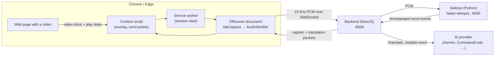

# Caption AI

Bilingual (English → Vietnamese), word-by-word captions for **any** HTML `<video>` embedded in any page — plus click-any-word explanations in the video's context.

No player API. No caption track. The extension captures the tab's actual audio, transcribes it locally with Whisper, and draws a synced overlay beside the video.

> **Status:** working prototype. Windowed transcription is the default; streaming mode exists behind a flag and is not yet tuned.

## Why

Existing tools each miss something:

- **YouTube/Udemy caption extensions** hook the player's own caption API, so they do nothing on an arbitrary `<video>` tag.
- **Browser/OS live captions** work anywhere but skip words and sentences, and never translate.
- **Cloud transcription** sends your audio off the machine.

Caption AI reads the audio stream itself, so it works on any player, any embedded `<video>`, including cross-origin iframes — and the audio never leaves your machine.

## How it works



Three things are worth knowing about the design:

- **Audio is captured with `chrome.tabCapture` in an offscreen document**, not with `captureStream()` on the element. That sidesteps CORS and tainted-media problems and still captures cross-origin iframes. The WebSocket lives in the offscreen document because MV3 service workers sleep after ~30s.
- **Words are anchored to the video clock, never to Whisper's absolute timestamps.** Each audio window is re-anchored, so drift cannot accumulate over a long video.
- **The AI key never reaches the browser.** Translation and word explanation go through the backend; the extension bundle contains no credentials and no key is ever sent to the page.

## Features

| | |
|---|---|
| **Word-by-word sync** | Highlighting advances with `video.currentTime`, so it survives pausing, scrubbing, and playback-rate changes. |
| **Bilingual overlay** | Current sentence with English above Vietnamese, positioned beside the video; movable, resizable, adjustable font size and opacity. |
| **Per-colour control** | English, Vietnamese, and the highlighted word each get an independent colour. |
| **Retained history** | The scroll panel keeps every line loaded in the session, clickable for re-reading, with a manual/auto-follow toggle. |
| **Click-any-word** | Look up a word as used in that sentence: meaning, translation, an example, pronunciation. |
| **Local transcription** | Whisper runs on your machine (`tiny`/`small`/`medium`, CPU int8). No audio is uploaded. |
| **Instant replay** | Already-watched ranges come back from a bounded transcript cache on seek, with no new transcribe round-trip. |
| **Any video** | Works on plain `http://`/`https://` pages, including videos inside cross-origin iframes and audio-only `<video>` elements. |
| **Language safety** | The source language is detected on the first window; a non-English source raises a notice instead of producing English hallucinations. |
| **CC fullscreen** | Native fullscreen hides page DOM, so the extension ships its own fullscreen button that wraps video + overlay. |

## Repository layout

```
caption-on-embbed-video/
├── extension/     Chrome/Edge MV3 extension — TypeScript, bundled with esbuild
├── backend/       NestJS orchestrator — WebSocket gateway, transcript cache, AI layer
├── sidecar/       Python service — faster-whisper word-level ASR
├── dev.sh         One-command dev launcher for the whole stack
└── README.md
```

| Component | Role |
|---|---|
| `extension/` | Detects `<video>`, owns the video clock, captures tab audio, renders the overlay and word panel. |
| `backend/` | Bridges extension ↔ sidecar, aligns word times to the video clock, caches transcripts, serves `/translate` and `/explain-word` behind a pluggable provider interface. |
| `sidecar/` | Receives 16 kHz mono PCM and emits word events with timestamps. Localhost only. |

## Requirements

- **Chrome or Edge** (MV3). Capturing requires a normal `http://` or `https://` page — browser-internal pages cannot be captured.
- **Node.js 20+** for the backend and the extension build.
- **Python 3.10+** for the sidecar. The first run downloads the Whisper model.
- **Developed and tested on Windows.** Run `dev.sh` from Git Bash there. The components themselves are portable, but the launcher's port pre-flight parses `netstat -ano`, so on macOS/Linux use `SKIP_PORT_CHECK=1` or start each piece by hand.

## Setup

**1. Sidecar**

```bash
cd sidecar
python -m venv .venv
.venv/Scripts/activate        # Windows;  source .venv/bin/activate on macOS/Linux
pip install -r requirements.txt
```

**2. Backend**

```bash
cd backend
npm install
```

Then create `backend/.env` with your provider settings (see [Configuration](#configuration)).

**3. Extension**

```bash
cd extension
npm install
npm run build
```

In Chrome, open `chrome://extensions`, enable **Developer mode**, click **Load unpacked**, and select the `extension/` directory. Edge uses `edge://extensions` and the same steps.

After changing extension source, rebuild (`npm run build`) and press **Reload** on the extension card.

## Running

From the repository root:

```bash
./dev.sh
```

That starts the sidecar, waits for it to become healthy, then starts the backend with live reload. It also watches the sidecar for Python changes and restarts it. `Ctrl+C` stops only the processes it started — a port already claimed by something else is reported and left alone.

Useful flags: `DEV_QUIET=1` silences the log stream, `SKIP_PORT_CHECK=1` bypasses the port pre-flight, `SIDECAR_PORT` / `BACKEND_PORT` override the defaults.

To run a component alone:

```bash
cd sidecar && .venv/Scripts/python.exe -m uvicorn app.main:app --host 127.0.0.1 --port 9000
cd backend && npm run start:dev
```

Then **click the extension icon** on the tab you want to caption and turn captions on. Capture has to start from the toolbar action: Chrome grants `activeTab` only after you invoke the extension on that page, and clicking an in-page button does not count.

## Configuration

**`backend/.env`** (gitignored — the provider key lives here and only here):

| Variable | Default | Purpose |
|---|---|---|
| `AI_PROVIDER` | `commandcode` | Provider to use: `commandcode` or `gemini`. |
| `AI_API_KEY` | — | Provider key. If unset, the app still boots and English captions still work; translation and word explanation are disabled. |
| `AI_MODEL` | provider default | Overrides the provider's model. Defaults are cheap tiers — translation is high-frequency short-text work. |
| `AI_BASE_URL` | provider default | Overrides the endpoint (`commandcode` provider only). |
| `AI_MAX_RPM` | `15` | Requests per 60-second window. Sized for the Gemini free tier; requests are batched to stay under it. |
| `CAPTION_MODE` | `windowed` | `windowed` or `streaming`. |
| `PORT` | `8000` | Backend HTTP + WebSocket port. |
| `EXPLAIN_CACHE_TTL_MS` | `1800000` | Word-explanation cache lifetime (30 min). |
| `EXPLAIN_CACHE_MAX_ENTRIES` | `500` | Word-explanation cache size bound. |

**Sidecar environment:**

| Variable | Default | Purpose |
|---|---|---|
| `WHISPER_MODEL` | `tiny` | `tiny`, `small`, or `medium`. Larger is more accurate and slower. |
| `CAPTION_MODE` | `windowed` | `windowed` or `streaming`; keep both sides in sync. |
| `WHISPER_LOCAL_FILES_ONLY` | `0` | Set to `1` to forbid model downloads and use only cached weights. |

## HTTP API

The backend exposes plain HTTP alongside its WebSocket, useful for poking the AI layer directly:

```bash
curl -X POST http://localhost:8000/translate \
  -H 'Content-Type: application/json' \
  -d '{"sentence":"Artificial intelligence is transforming the way we work.","from":"en","to":"vi"}'

curl -X POST http://localhost:8000/explain-word \
  -H 'Content-Type: application/json' \
  -d '{"word":"transforming","context":"Artificial intelligence is transforming the way we work.","lang":"vi"}'

curl http://localhost:8000/health
```

`GET /health` aggregates backend and sidecar readiness — the extension's popup and status notice read it.

## Testing

```bash
cd backend
npm test          # unit specs
npm run test:cov  # with coverage
```

The backend suite covers the video-clock alignment, transcript cache, provider error semantics (429 quota vs 503 overload), rate limiter, and the WebSocket gateway.

Type-check the extension with `cd extension && npm run typecheck`.

## Performance

Transcription runs in 3-second windows with a 1.5-second overlap, so words arrive in batches rather than as a live stream. Measured window + decode latency in the sidecar log sits at roughly p50 ≈ 3.4s / p90 ≈ 3.8s; what a viewer perceives is a little better than the worst case, since the wait shrinks toward the end of a window.

This is a structural floor of windowed transcription, not a tuning problem — a ten-times-faster model would not move it. Genuinely low latency (<2s) requires streaming ASR, which is planned but not yet benchmarked.

## Roadmap

- **Streaming ASR** — sub-2s latency, replacing the windowed batch path.
- **Transcript export UI** — the SRT/VTT/TXT serializer and the download handler already exist in the service worker; there is no button wired to them yet.

## Contributing

This is a personal learning project, so it is not set up to accept outside contributions right now. If you want to build on it, fork it.

## License

No license has been chosen yet, so all rights are reserved by default. If you intend to reuse this code, open an issue.
